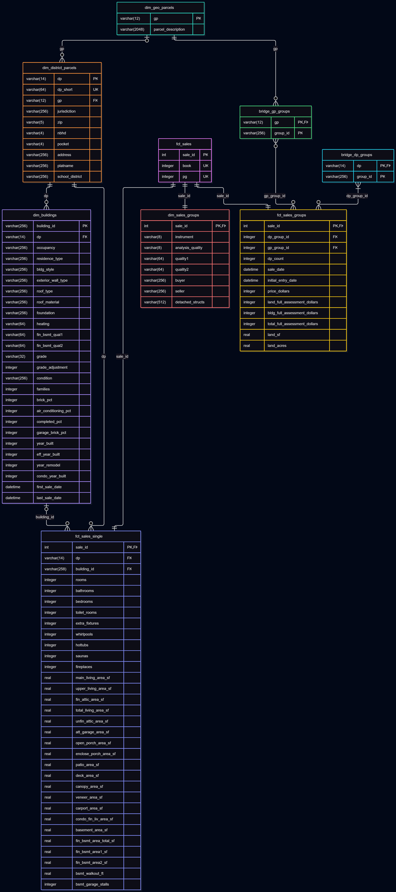

# Design Document

By Robert Laughlin

Video overview: https://www.youtube.com/watch?v=NL1MBbQGG1I 

## Scope

This database is a simple random sample of $2,000$ public residential Polk County parcel/housing [sale and assessment records](https://www.assess.co.polk.ia.us/cgi-bin/web/tt/infoqry.cgi?tt=downloads/res_sales_polk) over 1990-2026, transformed using my own personal [data processing pipeline](https://github.com/RobLaughlin/polk-county-ingestion-pipeline). This database was created to develop and structure the raw residential sale records in order to perform efficient descriptive statistics, analysis, and stage for potential ML modeling in the future.

This is not an exhaustive list of all sale records, and the scope of sale records are only included in the location of Polk County, Iowa, over the time period of 1990-2026. The type of sale records are residential only. Any non-residential, outside the time period 1990-2026 or outside of Polk County, Iowa, is out of scope.

## Functional Requirements

Users should be able calculate descriptive statistics efficiently for relevant attributes: Median sale price over a certain time period, median assessment value per square foot of land, minimum/maximum number of rooms, etc. The demo sample size of $2,000$ sale records is relatively small in comparison to the total dataset size of ~$400,000$, so I would be cautious about making inferences or training models on the demo dataset.

## Representation

### Entities

There are three categories of entities in our database: Bridges, Facts, and Dimensions. The fact and dimension entities are categorized according to a [Star Schema](https://en.wikipedia.org/wiki/Star_schema), where the fact entities represent quantitative features and the dimension entities represent descriptive features. The bridge entities are used for many-to-many relationships in grouping.

The `fct_sales` entity is the single source of truth between all sales entities. Each sale is hashed as the `sale_id` attribute using the `(book, pg)` attributes, and that `sale_id` is mapped one-to-one across all sale entities. At least one parcel is included in each sale, and the `dp_count` attribute in `fct_sales_groups` counts how many of those parcels are included. The `fct_sales_groups` and `dim_sales_groups` entities describe features of sales that apply to the entire sale as a whole including all parcels in the sale. For example, the `land_sf` attribute in `fct_sales_groups` is the total area of ALL the parcels included in the sale. `bridge_dp_groups` and `bridge_gp_groups` assign group_id's to both district parcels and geo parcels for each sale, respectively.

`fct_sales_single` is the entity which holds the quantitative attributes of the primary parcel for each sale (`dp`). The sale of each primary parcel may or may not have building features tied to each sale. For example, the sale of land alone would have a NULL `building_id` attribute, whereas the sale of a residential home would have a `building_id` attribute. The `dim_building` entity holds all such descriptive features of the building related to the parcel, if it exists, keyed by `building_id`.

`dim_district_parcels` holds district parcel data that is relatively unchanging over time such as zip, jurisdiction, address, etc. `dim_geo_parcels` is a similar parcel identifier.

Some attributes must have an exact length such as `dp` (length 14), `gp` (length 12), and `zip` (length 5), whereas some attributes such as `parcel_description` or `address` need a more flexible amount of characters. Generally, we use a relatively liberal VARCHAR($2^n$) for attributes that may require more space. Sale prices, assessment values, areas, single parcel sale features (bathrooms, bedrooms, hottubs, etc), all require non-negativity constraints. Percentage values such as `air_conditioning_pct` and `garage_brick_pct` require values between $0$ and $100$.

### Relationships

Some district parcels ingested from our dataset have NULL `gp` values, and so `dim_district_parcels` has a zero-to-one relationship with `dim_geo_parcels`.

Each sale must have at least district parcel (`dp`), so each sale group has at least one district parcel group. Sale groups having a geo parcel group is optional, so `fct_sales_groups` has a zero-to-many relationship with `bridge_gp_groups` and one-to-many with `bridge_dp_groups`.

It's important to note that since there may be many sales of the same parcel, and building features may change over time due to renovations for example, that dp is not a unique identifier for `building_id`, and that parcels may have zero or many associated `building_id`'s. Furthermore, a sale may not even have a building associated with it, such as the sale of land only, so the `fct_sales_single` has a zero-to-one relationship with `dim_buildings`.

## Optimizations

It's very common we're going to join and filter by parcel identifiers and building identifiers such as dp, gp, and building_id, so all tables with non-primary key fields are indexed by those attributes. Additionally, we index fct_sales_groups by assessment values, sale prices, and land measurements, as those are going to be the particular metrics of interest for housing sale analysis.

We also included two views that will be used frequently: A view for single parcel sales (sales with dp_count = 1), and a view for high quality single family sales built on top of the single parcel sales view, which filters out a lot of poor quality/outlier single family housing sales that may skew our analysis.

## Limitations

In this section you should answer the following questions:

This database is only a small subset of sales data collected in Polk County, Iowa, between 1990 and 2026. To expand for data outside of this region and generalize to the whole USA, we would have to include additional attributes to `dim_district_parcels` such as state, city, county, etc.

Furthermore, since we currently manually run queries in BQ to extract the data for this database, every time we make model changes we would have to make sure that our BQ queries extract the correct columns and insert them in the correct order. The current database is a reflection of the BQ models at the current point in time, not a constantly up-to-date snapshot of sales data.
